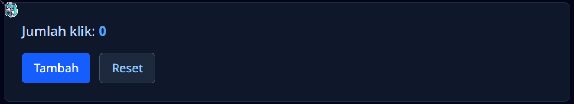
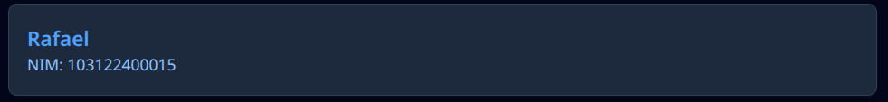
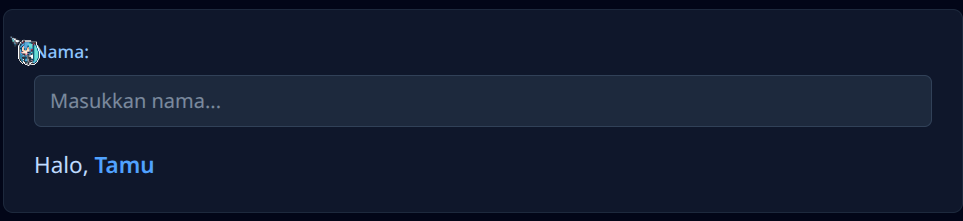
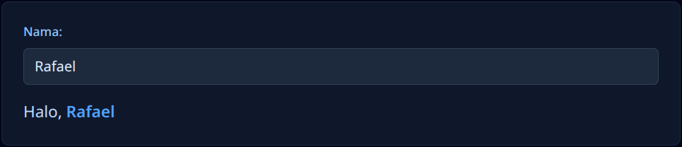
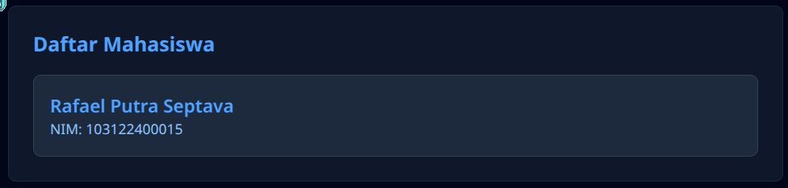
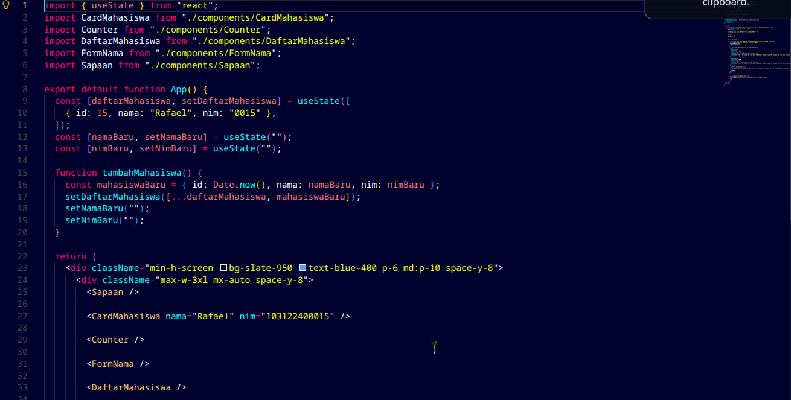
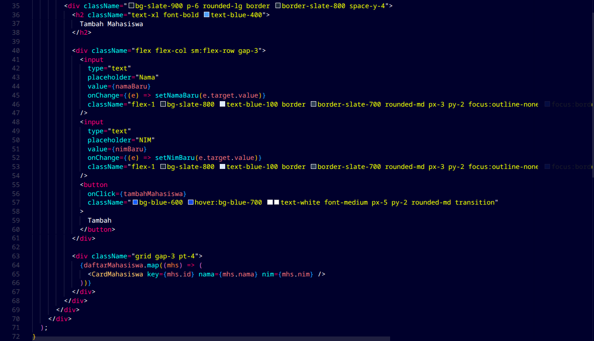
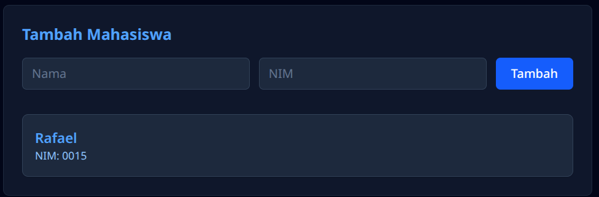
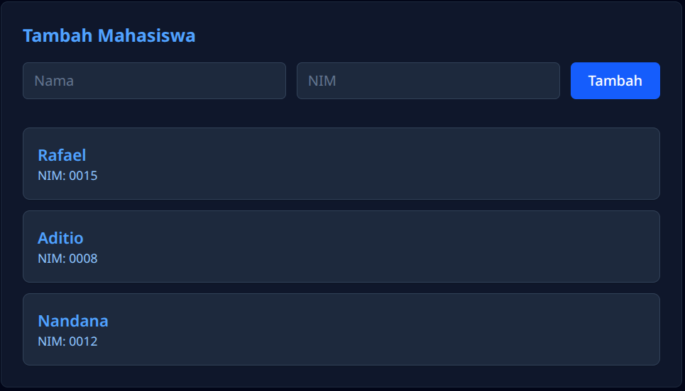

Rafael Putra Septava  
103122400015  
SE-08-01  

## Screenshot

  
Saya membuat function Sapaan untuk ucapan selamat datang.
  

  
Fuction CardMahasiswa dengan parameter props yang nantinya bisa diisi dengan variabel seperti props.nama dan props.nim
  

  
  
Fuction Counter menggunakan const jumlah dan setJumlah sebagai useState yang nilai awalnya nol. Klik tombol tambah sehingga angka akan naik dan klik tombol reset sehingga angka akan balik ke nol. Menggunakan onClick.
  

  
  
Fuction FormNama menggunakan const nama dan setNama sebagai useState dengan string kosong. Sehingga user bisa memasukan nama mereka. Menggunakan onChange.
  

  
Fuction DaftarMahasiswa yang menampilkan nama mahasiswa yang dimana nama mahasiswa itu diambil dari function CardMahasiswa. Menggunakan map.
  

  
  
Lalu di function App itu menaruhkan semua function didalam satu file sehingga dapat tersusun.
  

  
  
Saya juga menambahkan function TambahMahasiswa yang digabung didalam function App.

