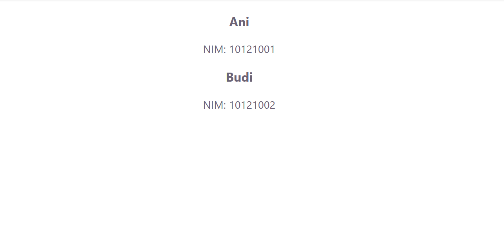
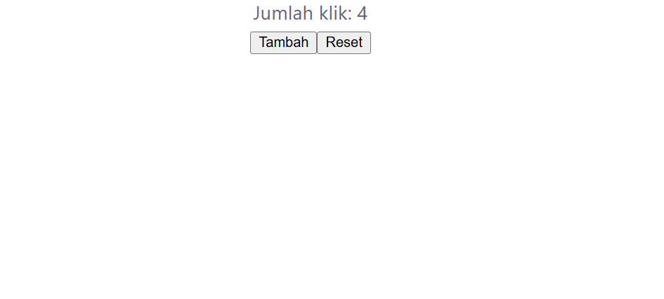
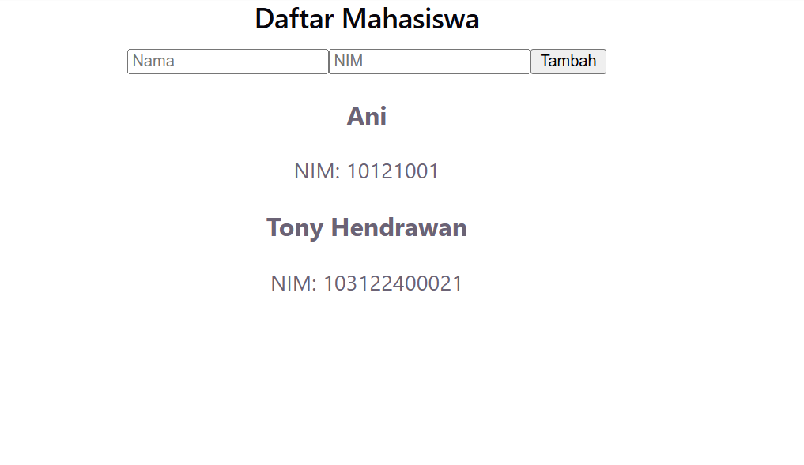

# Modul-6-React-Dasar

# Tugas Praktikum Pemrograman Web

## Pengenalan React: Komponen, Props, State, Event, dan Render List

Konsep-konsep dasar pengembangan aplikasi web berbasis React menggunakan Vite, meliputi pembuatan komponen fungsional, pengiriman data melalui props, pengelolaan data dinamis dengan state penanganan event, serta menampilkan daftar data secara dinamis.

### Screenshot Output

#### 1. Instalasi dan Setup Vite
Inisialisasi dan instalasi dependensi proyek React menggunakan Vite.


#### 2. Functional Component
Komponen pertama (`Sapaan.jsx`) yang menampilkan teks selamat datang.


#### 3. Props
Penggunaan props pada `CardMahasiswa.jsx` untuk menampilkan data nama dan NIM yang dikirim dari komponen induk.


#### 4. State
Penggunaan hook `useState` pada `Counter.jsx` untuk menyimpan dan memperbarui nilai hitungan secara interaktif.


#### 5. Penanganan Event
Komponen input nama (`Event.jsx`) yang menangani event ketikan teks pengguna secara real-time.


#### 6. Render List
Menampilkan daftar mahasiswa secara dinamis menggunakan fungsi `.map()` pada `RenderList.jsx`.


#### 7. Gabungan (State, Event, & Render List)
Aplikasi terpadu pada `App.jsx` yang memiliki fitur form input data mahasiswa baru nama dan NIM serta menampilkan daftarnya secara langsung.


---

### Struktur File

```
103122400021_Tony Hendrawan/
├── README.md
├── assets/
│   ├── fungsional component.png
│   ├── gabungan.png
│   ├── instalasi vite.png
│   ├── penanganan event.png
│   ├── props.png
│   ├── render list.png
│   └── state.png
└── source_code/
    ├── public/
    ├── src/
    │   ├── assets/
    │   │   ├── hero.png
    │   │   ├── react.svg
    │   │   └── vite.svg
    │   ├── components/
    │   │   ├── CardMahasiswa.jsx
    │   │   ├── Counter.jsx
    │   │   ├── Event.jsx
    │   │   ├── PenangananEvent.jsx
    │   │   ├── RenderList.jsx
    │   │   └── Sapaan.jsx
    │   ├── App.css
    │   ├── App.jsx
    │   ├── index.css
    │   └── main.jsx
```
