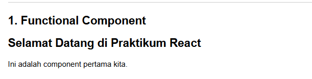
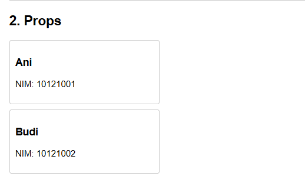
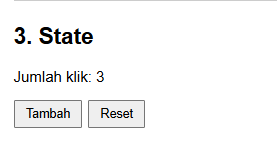
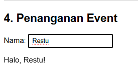
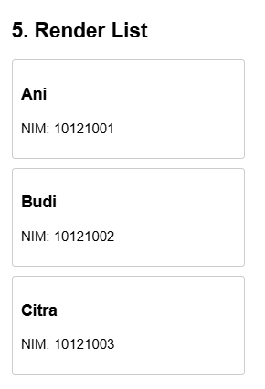
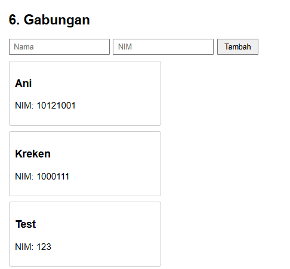

# LAPORAN PRAKTIKUM PEMROGRAMAN WEB
## TUGAS 4: REACT JS PRACTICAL GUIDE (MODUL 6)
### Implementasi Functional Component, Props, State, Penanganan Event, dan Render List

 

 
 

**Disusun Oleh :**

**Muhammad Restu Aditya / 103122400022**  
**SE-08-01**

 

**Asisten Praktikum :**  
Abu Abdirrahman Humaid Al-Atsary  
Hamka Zainul Ardhi

 

**Dosen Pengampu :**  
Arif Amrulloh, S.Kom., M.Kom.

 
 

### PROGRAM STUDI S1 SOFTWARE ENGINEERING
### FAKULTAS INFORMATIKA
### TELKOM UNIVERSITY PURWOKERTO
### 2026

---

## 1. Functional Component (Sapaan.jsx)

Pada bagian pertama ini, saya membuat komponen fungsional sederhana bernama `Sapaan.jsx` yang bertindak sebagai komponen pembuka antarmuka. Komponen fungsional pada React modern merupakan fungsi JavaScript yang mengembalikan sintaks JSX berupa struktur elemen tampilan. Pada komponen ini, fungsi mengembalikan judul ucapan selamat datang beserta teks pengantar yang menerangkan bahwa komponen tersebut merupakan komponen pertama yang dibangun pada praktikum ini. Dengan memanfaatkan komponen fungsional, struktur antarmuka menjadi lebih ringkas, modular, serta mudah dipanggil berulang kali di dalam komponen utama `App.jsx` layaknya sebuah tag HTML mandiri.

---

## 2. Pengiriman Data Melalui Props (CardMahasiswa.jsx)

Komponen kedua yang saya buat adalah `CardMahasiswa.jsx` untuk menerapkan mekanisme pengiriman data antar komponen menggunakan props. Props bekerja layaknya argumen atau parameter fungsi yang dikirimkan dari komponen induk menuju komponen anak dan bersifat *read-only*. Pada implementasi ini, data berupa nama dan NIM mahasiswa dikirimkan dari komponen induk di `App.jsx`, kemudian diterima oleh `CardMahasiswa` melalui objek props untuk ditampilkan ke dalam elemen kartu mahasiswa. Melalui mekanisme props ini, satu komponen kartu yang sama dapat digunakan berulang kali untuk menampilkan berbagai data mahasiswa yang berbeda secara dinamis tanpa perlu menduplikasi kode HTML.

---

## 3. Pengelolaan Data Dinamis Menggunakan State (Counter.jsx)

Pada bagian ini, saya mengimplementasikan hook `useState` pada komponen `Counter.jsx` untuk mengelola data dinamis yang dapat berubah akibat interaksi pengguna. Variabel state `jumlah` diinisialisasi dengan nilai awal nol bersama fungsi pembaruannya yaitu `setJumlah`. Ketika tombol Tambah ditekan, fungsi `setJumlah` akan dieksekusi untuk menaikkan nilai hitungan secara bertahap, sementara tombol Reset akan mengembalikan nilai kembali ke angka nol. Setiap kali nilai state mengalami perubahan, React secara otomatis memicu proses *re-rendering* pada komponen tersebut sehingga angka yang muncul pada layar peramban selalu terbarui sesuai kondisi data terkini.

---

## 4. Penanganan Event dan Controlled Component (FormNama.jsx)

Pada komponen `FormNama.jsx`, saya mempraktikkan penanganan event pengguna melalui event listener `onChange` yang dikombinasikan dengan konsep *controlled component*. Kolom input teks dikaitkan secara langsung dengan state `nama`, sehingga setiap ketikan karakter dari pengguna akan langsung ditangkap oleh event handler untuk memperbarui nilai state secara *real-time*. Kalimat sapaan di bawah kolom input akan langsung merespons teks yang dimasukkan, serta secara otomatis menampilkan kata *Tamu* apabila kolom input sedang kosong. Pola ini memastikan bahwa nilai pada input formulir sepenuhnya dikendalikan oleh state React dan bukan oleh DOM peramban secara langsung.

---

## 5. Menampilkan Data Berulang Menggunakan Render List (DaftarMahasiswa.jsx)

Untuk menampilkan kumpulan data yang tersimpan di dalam sebuah array objek, saya membuat komponen `DaftarMahasiswa.jsx` memanfaatkan fungsi perulangan `.map()`. Array berisi data daftar mahasiswa diiterasi untuk merender komponen `CardMahasiswa` secara berulang sesuai dengan jumlah data yang ada. Pada setiap elemen yang dirender, saya menyertakan atribut unik `key` yang diambil dari ID masing-masing mahasiswa. Atribut `key` ini sangat penting bagi React agar sistem rekonsiliasi dapat mengenali dan melacak perubahan pada setiap elemen secara efisien saat terjadi penambahan, modifikasi, maupun penghapusan data.

---

## 6. Gabungan Seluruh Konsep dan Form Tambah Mahasiswa (App.jsx)

Bagian terakhir merupakan integrasi menyeluruh dari seluruh materi yang telah dipelajari ke dalam satu alur aplikasi terpadu pada berkas `App.jsx`. Pada bagian ini, komponen fungsional, pengiriman props, pengelolaan state, penanganan event, dan render list digabungkan bersama sebuah formulir penambahan data mahasiswa baru secara interaktif. Pengguna dapat mengisikan nama dan NIM pada formulir, lalu saat tombol Tambah diklik, objek data mahasiswa baru akan dibuat dan dimasukkan ke dalam state array `daftarMahasiswa` menggunakan *spread operator*. Begitu state diperbarui, daftar kartu mahasiswa di bagian bawah akan langsung bertambah secara otomatis tanpa perlu memuat ulang halaman.
