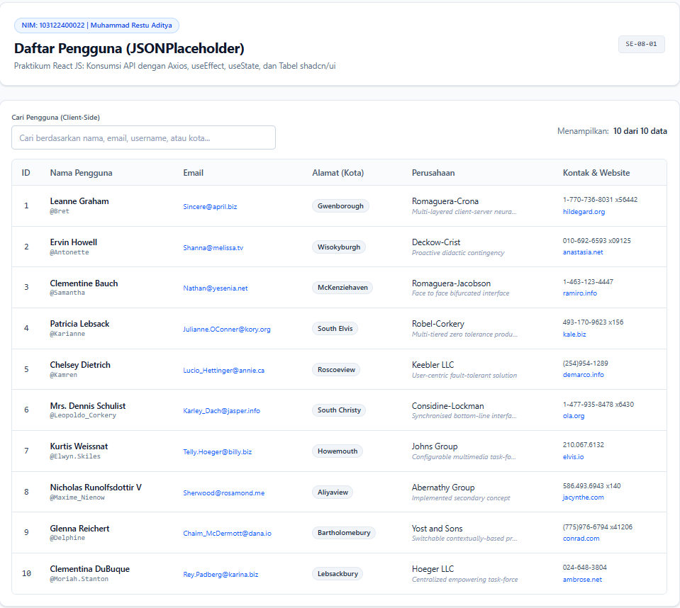
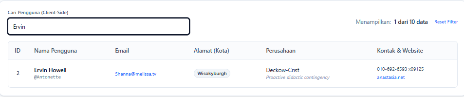

# TUGAS PRAKTIKUM PEMROGRAMAN WEB
## TUGAS 4: FUNDAMENTAL REACT JS & KONSUMSI API
### Menampilkan Data Pengguna JSONPlaceholder Menggunakan Axios dan Tabel shadcn/ui

 

 
 

**Disusun Oleh :**

**Muhammad Restu Aditya / 103122400022**  
**SE-08-01**

 

**Asisten Praktikum :**  
Abu Abdirrahman Humaid Al-Atsary  
Hamka Zainul Ardhi

 

**Dosen Pengampu :**  
Arif Amrulloh, S.Kom., M.Kom.

 
 

### PROGRAM STUDI S1 SOFTWARE ENGINEERING
### FAKULTAS INFORMATIKA
### TELKOM UNIVERSITY PURWOKERTO
### 2026

---

## 1. Penjelasan Program

Aplikasi ini merupakan program berbasis React yang dibangun menggunakan bundler Vite untuk mendemonstrasikan konsumsi REST API secara asinkron menggunakan pustaka Axios, pengelolaan state berbasis React Hook, serta perenderan data ke dalam antarmuka tabel modern bergaya shadcn/ui. Program ini terhubung ke layanan publik JSONPlaceholder pada endpoint `/users` guna mengambil sekumpulan data pengguna lengkap seperti identitas, username, email, alamat, kontak, dan nama perusahaan. Melalui integrasi ini, seluruh proses pengambilan data ditangani pada daur hidup komponen tanpa perlu menyegarkan peramban, serta dilengkapi dengan sistem pencarian client-side yang interaktif dan responsif.

---

## 2. Penjelasan Fitur dan Implementasi Kode

Seluruh arsitektur aplikasi disusun menggunakan komponen fungsional React dengan penerapan React Hooks standar industri, meliputi `useState` untuk manajemen state lokal dan `useEffect` untuk menangani efek samping pemanggilan API jaringan.

### 1. Pengambilan Data Pengguna dan Tampilan Tabel

Pengambilan data pengguna dieksekusi secara otomatis saat komponen pertama kali dimuat ke dalam peramban menggunakan hook `useEffect` dengan array ketergantungan kosong. Fungsi asinkron di dalamnya memanggil pustaka `axios.get()` menuju endpoint `https://jsonplaceholder.typicode.com/users`, kemudian hasil data respons server disimpan ke dalam state `users` menggunakan fungsi pembaruan `setUsers`. Status proses dikawal oleh state `loading` dan `error` sehingga antarmuka mampu memberikan umpan balik visual yang informatif sebelum data selesai dirender. Setelah data tersedia, seluruh baris dipetakan secara dinamis ke dalam komponen tabel semantik yang mengadopsi standar desain shadcn/ui berbasis utilitas Tailwind CSS.

### 2. Fitur Pencarian Data Pengguna (Client-Side Search)

Fitur pencarian bekerja sepenuhnya di sisi klien tanpa mengirimkan request tambahan ke server luar setiap kali pengguna mengetik kata kunci. Nilai input teks dikendalikan secara dua arah melalui state `searchTerm` menggunakan event listener `onChange`. Program kemudian menyaring array data pengguna secara *real-time* memanfaatkan metode `filter()`, di mana teks pencarian dicocokkan terhadap beberapa atribut data sekaligus, seperti nama lengkap, username, alamat email, nama kota, dan nama perusahaan. Antarmuka juga menyajikan indikator jumlah data yang berhasil disaring serta menyediakan tombol reset untuk mengembalikan tampilan ke daftar data semula.

---

## 3. Komponen Antarmuka dan Styling shadcn/ui

Penyusunan antarmuka pengguna menerapkan prinsip modularitas komponen mandiri yang memisahkan elemen dasar UI ke dalam berkas tersendiri, seperti komponen `Table`, `TableHeader`, `TableBody`, `TableRow`, `TableHead`, dan `TableCell` pada folder komponen UI. Seluruh penataan visual memanfaatkan Tailwind CSS untuk menghasilkan tampilan tabel yang bersih, memiliki kontras warna yang nyaman, dilengkapi efek sorot baris (*row hover*), serta menyematkan penanda badge status dan watermark identitas mahasiswa secara jelas di bagian kepala halaman.
