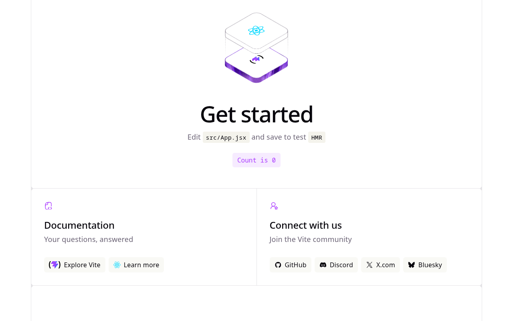
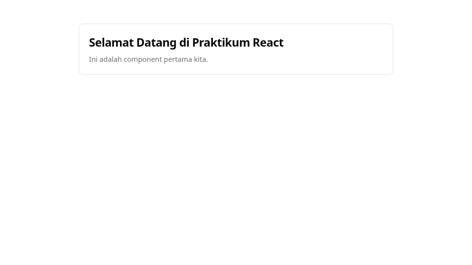
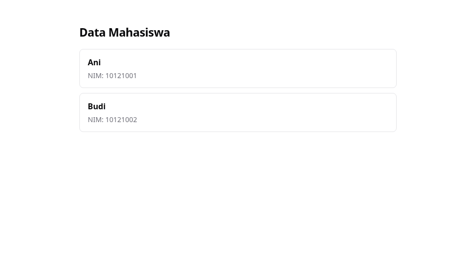
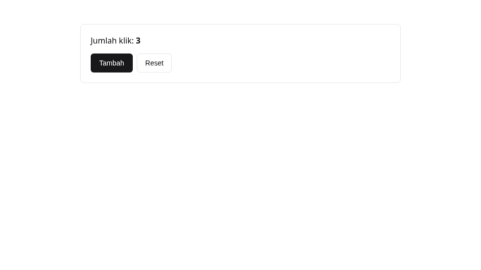
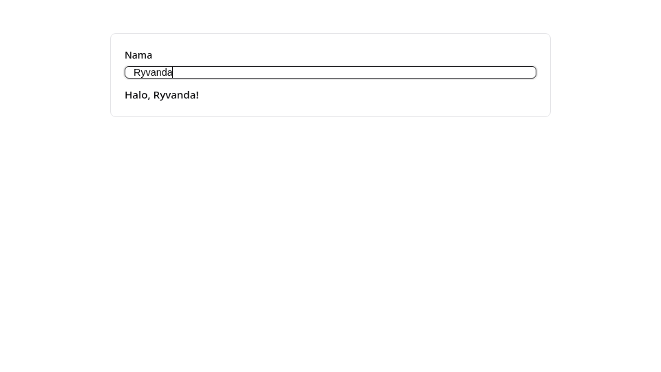
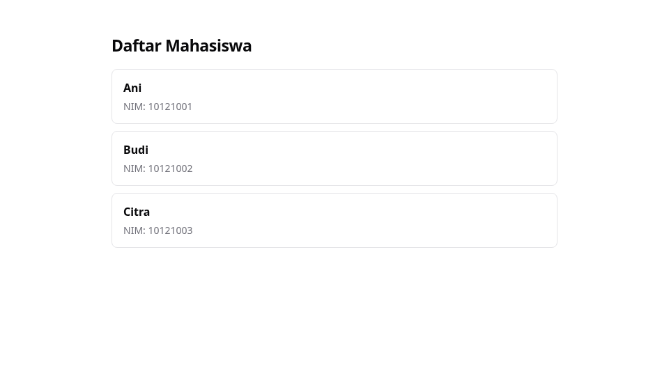
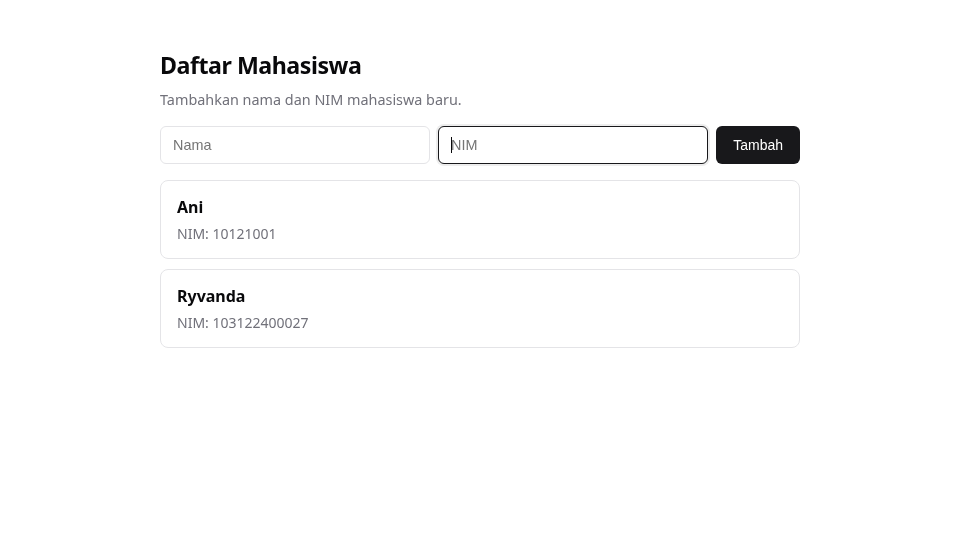

# Laporan Tugas 4 — Fundamental React JS

## Identitas Mahasiswa

- **Nama:** Ryvanda
- **NIM:** 103122400027
- **Kelas:** SE 08-01

---

## Deskripsi Aplikasi

Implementasi praktikum **Fundamental React JS (Modul 6)** menggunakan **React + Vite** dengan tampilan minimalis netral yang mencakup seluruh konsep dasar React sesuai urutan materi pada modul:

1. **Functional Component** (`Sapaan.jsx`) — membuat komponen fungsional sederhana yang menampilkan pesan sambutan.
2. **Props** (`CardMahasiswa.jsx`) — mengirimkan data `nama` dan `nim` dari komponen induk ke komponen anak melalui `props`.
3. **State** (`Counter.jsx`) — mengelola nilai hitungan klik yang dinamis menggunakan hook `useState`.
4. **Penanganan Event** (`FormNama.jsx`) — menangkap perubahan input teks menggunakan event `onChange` secara real-time.
5. **Render List** (`DaftarMahasiswa.jsx`) — menampilkan daftar data mahasiswa dari array menggunakan `.map()` dan atribut `key` unik.
6. **Gabungan (State, Event & Render List)** (`App.jsx`) — menggabungkan form input nama dan NIM mahasiswa baru dengan daftar kartu mahasiswa yang diperbarui langsung pada state.

---

## Struktur Folder

```
103122400027_Ryvanda/
├── .gitignore
├── .oxlintrc.json
├── README.md
├── index.html
├── package-lock.json
├── package.json
├── vite.config.js
├── assets/
│   ├── functional-component.png
│   ├── gabungan.png
│   ├── instalasi-vite.png
│   ├── penanganan-event.png
│   ├── props.png
│   ├── render-list.png
│   └── state.png
├── public/
│   ├── favicon.svg
│   └── icons.svg
└── src/
    ├── App.css
    ├── App.jsx
    ├── index.css
    ├── main.jsx
    └── components/
        ├── CardMahasiswa.jsx
        ├── Counter.jsx
        ├── DaftarMahasiswa.jsx
        ├── FormNama.jsx
        └── Sapaan.jsx
```

---

## Cara Menjalankan Aplikasi

1. Pastikan **Node.js** sudah terinstal di komputer Anda.
2. Masuk ke direktori project:
   ```bash
   cd 103122400027_Ryvanda
   ```
3. Pasang seluruh dependensi:
   ```bash
   npm install
   ```
4. Jalankan server pengembangan:
   ```bash
   npm run dev
   ```
5. Buka URL lokal yang muncul di terminal (umumnya `http://localhost:5173`).
6. Untuk memeriksa linter dan membuat build produksi:
   ```bash
   npm run lint
   npm run build
   ```

---

## Screenshot Output

### 1. Instalasi dan Setup Vite


### 2. Functional Component (`Sapaan.jsx`)


### 3. Props (`CardMahasiswa.jsx`)


### 4. State (`Counter.jsx`)


### 5. Penanganan Event (`FormNama.jsx`)


### 6. Render List (`DaftarMahasiswa.jsx`)


### 7. Gabungan (State, Event & Render List)


