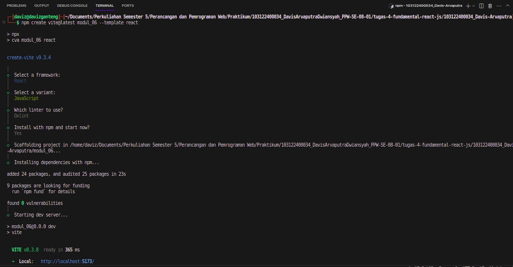
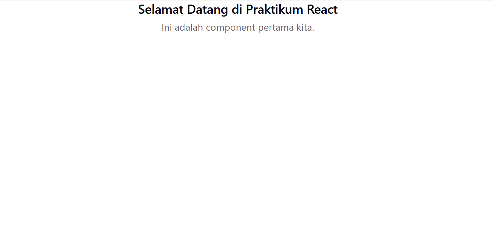
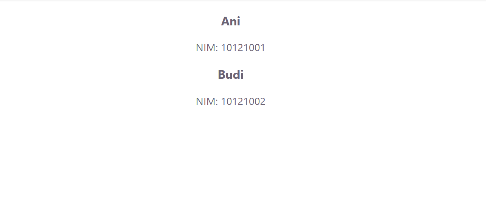
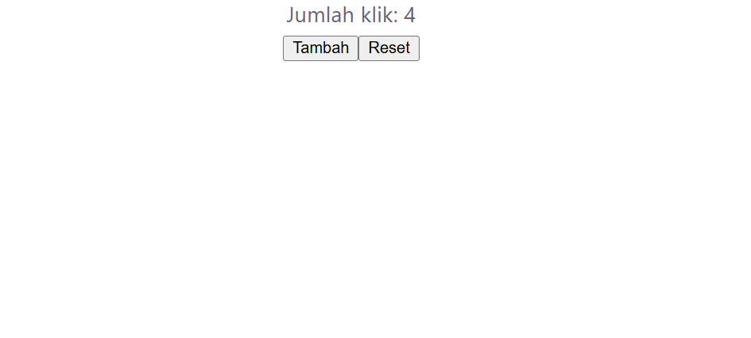
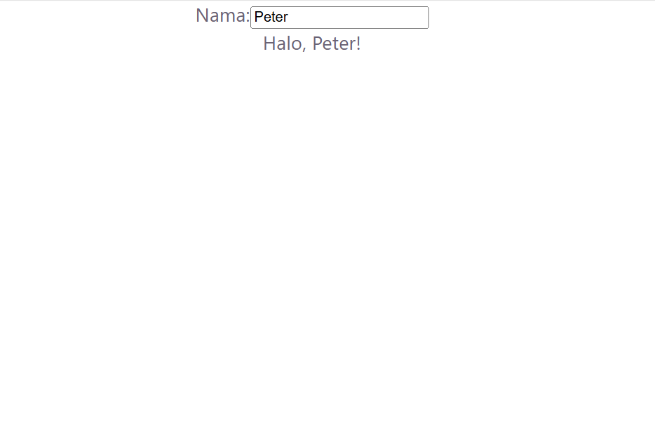
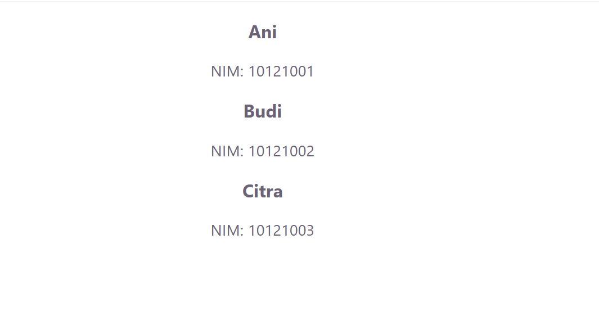
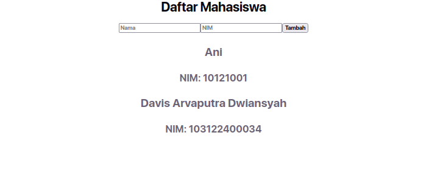

# Modul-6-React-Dasar

# Tugas Praktikum Pemrograman Web

```Nama: Davis Arvaputra Dwiansyah, NIM: 103122400034```

## Pengenalan React: Komponen, Props, State, Event, dan Render List

Pengenalan dasar React ini berfokus pada fondasi pembuatan aplikasi web interaktif yang efisien, mulai dari Komponen sebagai blok bangunan modular, Props untuk mengirim data antar komponen, State guna mengelola data dinamis yang interaktif, Event untuk menangani aksi pengguna secara real-time, hingga Render List yang memudahkan kita menampilkan daftar data secara dinamis menggunakan perulangan.

### Screenshot Output

#### 1. Instalasi dan Setup Vite
Inisialisasi dan instalasi dependensi proyek React menggunakan Vite.


#### 2. Functional Component
Komponen pertama (`Sapaan.jsx`) yang menampilkan teks selamat datang.


#### 3. Props
Penggunaan props pada `CardMahasiswa.jsx` untuk menampilkan data nama dan NIM yang dikirim dari komponen induk.


#### 4. State
Penggunaan hook `useState` pada `Counter.jsx` untuk menyimpan dan memperbarui nilai hitungan secara interaktif.


#### 5. Penanganan Event
Komponen input nama (`Event.jsx`) yang menangani event ketikan teks pengguna secara real-time.


#### 6. Render List
Menampilkan daftar mahasiswa secara dinamis menggunakan fungsi `.map()` pada `RenderList.jsx`.


#### 7. Gabungan (State, Event, & Render List)
Aplikasi terpadu pada `App.jsx` yang memiliki fitur form input data mahasiswa baru nama dan NIM serta menampilkan daftarnya secara langsung.


---
